<p align="center">
  <a href="https://mozhi-khaki.vercel.app">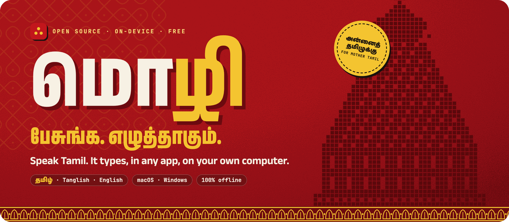</a>
</p>

<p align="center">
  <a href="https://github.com/Kamal007OLica/mozhi/releases"></a>
  
  
  <a href="LICENSE"></a>
  <a href="https://mozhi-khaki.vercel.app"></a>
</p>

<h3 align="center">Double-tap <kbd>Control</kbd>. Speak தமிழ், Tanglish or English.<br>Your words land in the app you're already in.</h3>

<p align="center">
  <a href="https://github.com/Kamal007OLica/mozhi/releases"><b>⬇ Download for Mac or Windows</b></a>
  &nbsp;·&nbsp; <a href="https://mozhi-khaki.vercel.app">Website</a>
  &nbsp;·&nbsp; <a href="#building-from-source">Build from source</a>
  &nbsp;·&nbsp; <a href="https://github.com/Kamal007OLica/mozhi/issues/new/choose">Report an issue</a>
</p>

<p align="center">
  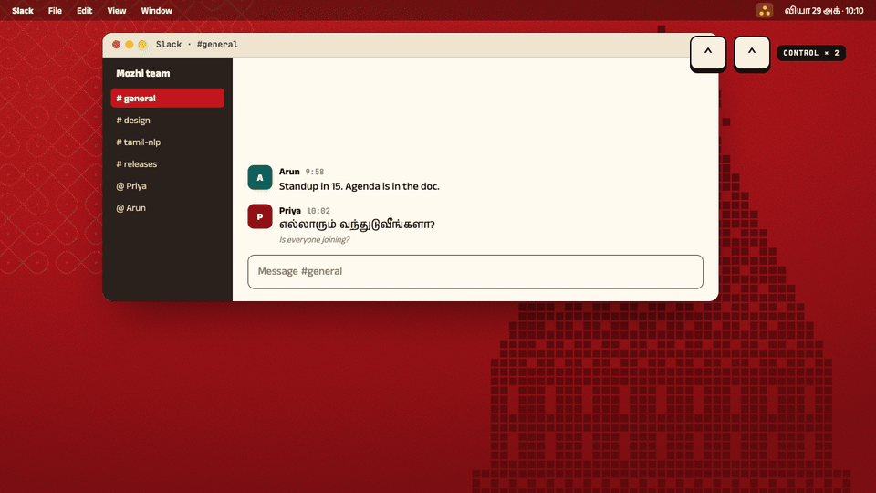
  <br>
  <sub>The real overlay, recorded from the app. <a href=".github/readme/demo.mp4">▶ Watch in HD</a></sub>
</p>

<p align="center">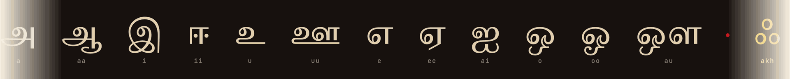</p>

## ஃ மொழி என்றால் · What Mozhi is

**மொழி** means *language*. Mozhi is free, open-source voice typing built for Tamil. It listens only
while you dictate, turns your speech into text **on your own computer**, and pastes it wherever your cursor is:
Slack, WhatsApp Desktop, Gmail, Notes, Word, VS Code.

> தமிழ் பேசுறவங்க, தங்க சொந்த மொழியில, தங்க சொந்தக் கணினியிலேயே பேசி எழுதணும்.
> <br><sub>Tamil speakers should be able to write by voice in their own language, on their own computer.</sub>

<p align="center">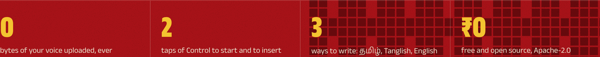</p>

## எப்படி? · How it works

<p align="center">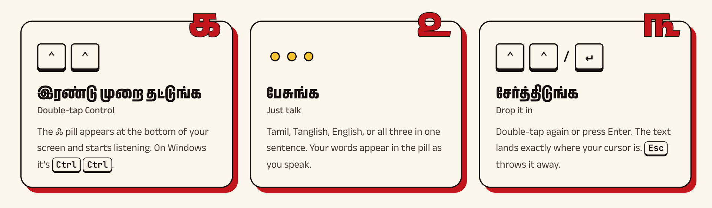</p>

| Do this | To |
| :-- | :-- |
| <kbd>⌃</kbd> <kbd>⌃</kbd> &nbsp;(<kbd>Ctrl</kbd> <kbd>Ctrl</kbd> on Windows) | Start listening |
| <kbd>⌃</kbd> <kbd>⌃</kbd> or <kbd>↵</kbd> | Insert into the current app |
| <kbd>esc</kbd> | Cancel and throw the audio away |
| Click the mode chip | Switch between Auto, தமிழ், Tanglish and English |
| Drag the overlay | Move it. Mozhi remembers the spot |

**It never types into the wrong window.** The overlay always names the app it will write into, and the field
when it can tell. Switch apps mid-sentence and it follows you. Only a clean double-tap counts, so <kbd>Ctrl</kbd>+<kbd>C</kbd>
never starts Mozhi, and <kbd>↵</kbd> and <kbd>esc</kbd> are captured only while it is listening.

## ஒரே குரல், மூன்று எழுத்து · Three ways to write

<p align="center">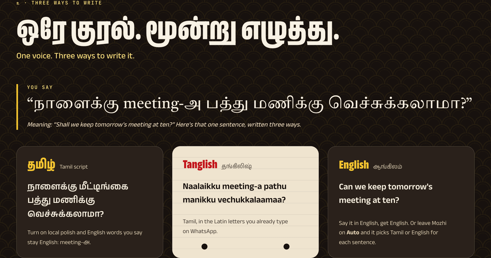</p>

| Mode | You get | Good for |
| :-- | :-- | :-- |
| **தமிழ்** | Tamil script | Messages, documents, anything formal |
| **Tanglish** | Tamil words in Latin letters (`naalaikku meeting irukku`) | Chats where everyone types Tanglish |
| **English** | English | When you're speaking English |
| **Auto** | Tamil or English, decided per sentence | Leave it on and forget it |

## ஃ The dot that listens

<p align="center">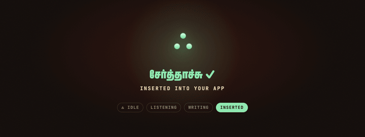</p>

The logo is **ஃ** (*āytham*), a letter only Tamil has. In the app it is alive: three dots at rest, a waveform
that follows your voice, the ஃ spinning inside Nataraja's ring of fire while Mozhi writes, and a green settle
when your words land. <a href=".github/readme/voice.mp4">▶ HD</a>

## செயலிக்குள் · Inside the app

<p align="center">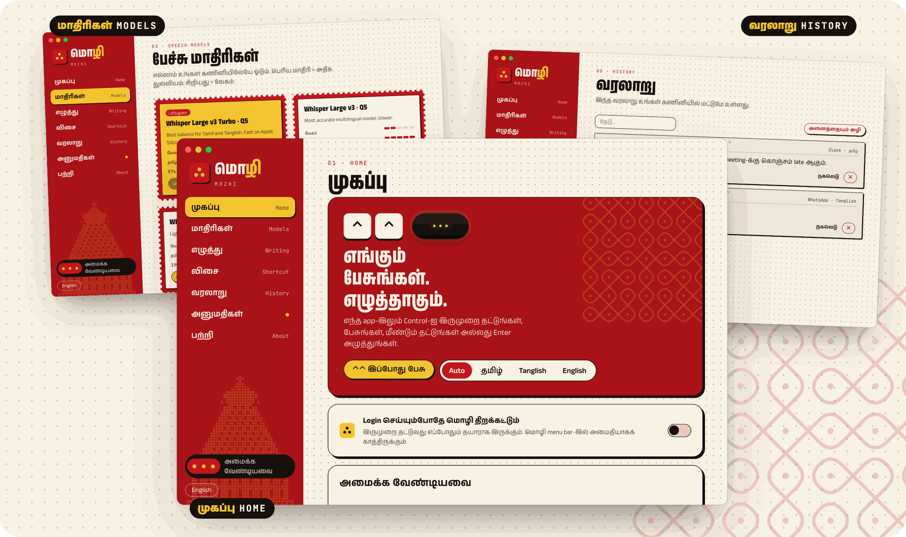</p>

Bilingual from the first screen (தமிழ் leads, English supports), with Home, Models, Writing, Shortcut, History,
Permissions and About. Everything you dictate stays in a local history you can search, copy or clear.

## தனியுரிமை · Private by design

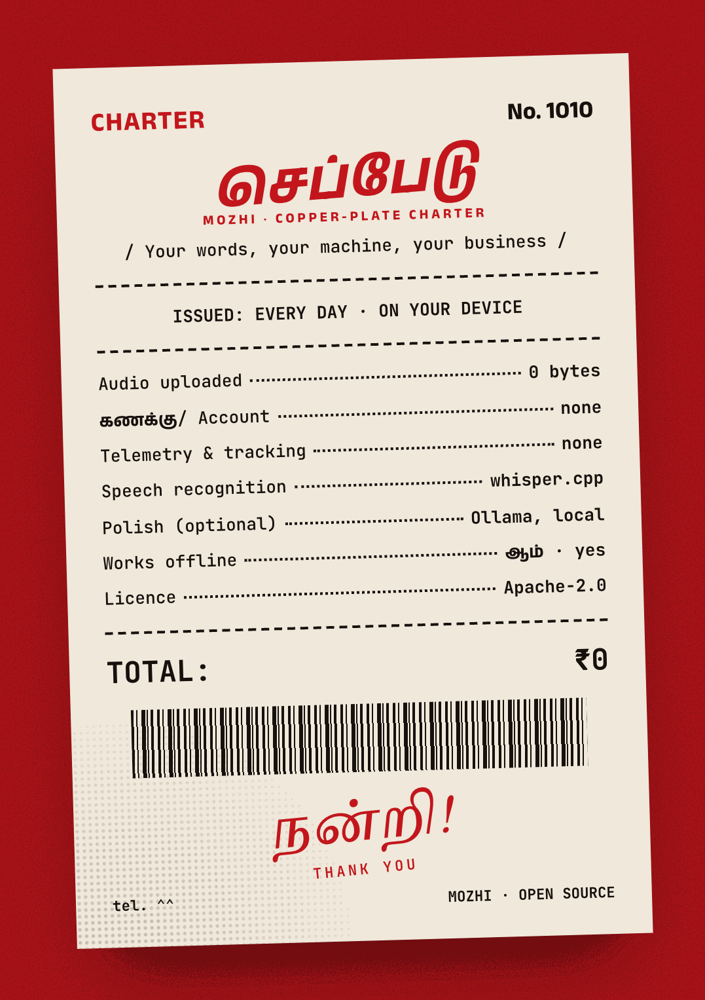

- **On-device speech.** [whisper.cpp](https://github.com/ggml-org/whisper.cpp) runs the Whisper model on your
  machine, on the GPU through Metal on Apple Silicon.
- **No account, no cloud, no telemetry.** Nothing to sign in to, nothing sent anywhere.
- **Voice activity detection.** Silero VAD keeps silence out of the model, so you don't get phantom words.
- **Optional local polish.** A free LLM in [Ollama](https://ollama.com) (default `gemma3:4b`) fixes
  punctuation and keeps English words in English. If it is slow or offline, Mozhi pastes the plain transcript.
- **Your clipboard comes back.** Mozhi pastes, then restores what you had copied.

<br clear="right">

## மாதிரிகள் · Speech models

<p align="center">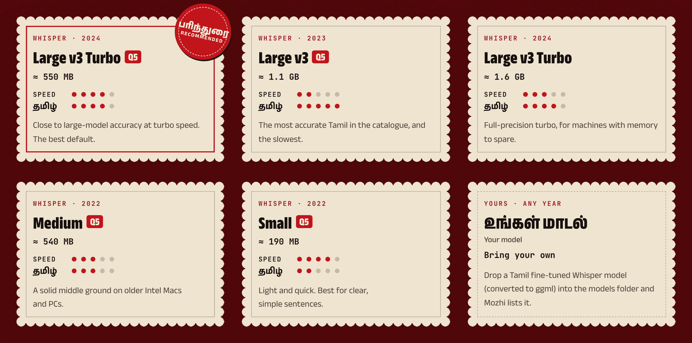</p>

Mozhi downloads a model on first run from Hugging Face and verifies it by SHA-256. The default,
**Whisper large-v3-turbo (Q5, about 550 MB)**, balances Tamil accuracy and speed. Smaller and larger models
are one click away in **Models**, and any ggml Whisper `.bin` you drop in the models folder shows up too,
including Tamil fine-tunes converted with [`scripts/convert-tamil-model.sh`](scripts/convert-tamil-model.sh).

## Install

Grab the latest build from [**Releases**](https://github.com/Kamal007OLica/mozhi/releases). These are unsigned beta builds.

<details open>
<summary><b>macOS</b> (Apple Silicon, macOS 12+)</summary>

1. Open the `.dmg` and drag **Mozhi** to Applications.
2. The first time, right-click Mozhi and choose **Open**, then **Open** again. If macOS still refuses, go to
   System Settings → Privacy & Security and click **Open Anyway**.
3. Allow **Microphone** (to hear you, only while you dictate) and **Accessibility** (to notice the double-tap,
   see which app you're in, and paste).
</details>

<details>
<summary><b>Windows</b> (10 or 11, 64-bit)</summary>

1. Run the `-setup.exe` (or the `.msi`).
2. If SmartScreen warns you, click **More info** → **Run anyway**.
</details>

On first launch Mozhi downloads the speech model. After that everything works offline.

## Building from source

You need Rust (stable), Node 20+, CMake, and the Xcode Command Line Tools on macOS or the MSVC build tools on Windows.

```bash
npm install
```

```bash
npm run desktop:dev
```

```bash
npm run desktop:build
```

The landing page lives in `apps/web` (`npm run web:dev`) and the brand system in `brand/`
(`npm run brand` regenerates every pattern; `python3 brand/scripts/build-book.py` rebuilds the brand book).
Every image in this README is recorded from the real app and site by [`scripts/readme`](scripts/readme/README.md).

<details>
<summary><b>Repository layout</b></summary>

```
apps/desktop/          Tauri 2 app
  src-tauri/src/       Rust core: controller, engine (audio + whisper), platform (hotkeys, paste)
  src/overlay/         the floating ஃ overlay
  src/app/             settings, models, history, onboarding
apps/web/              landing page (static, on Vercel)
brand/                 tokens, fonts, logo, generated Chola-era patterns, brand book
docs/ARCHITECTURE.md   how the pieces fit together
scripts/readme/        records the GIFs and renders the images in this README
```
</details>

## ஃ கதை · The story of the mark

<p align="center">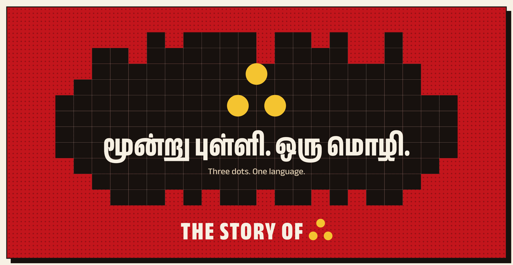</p>

<p align="center">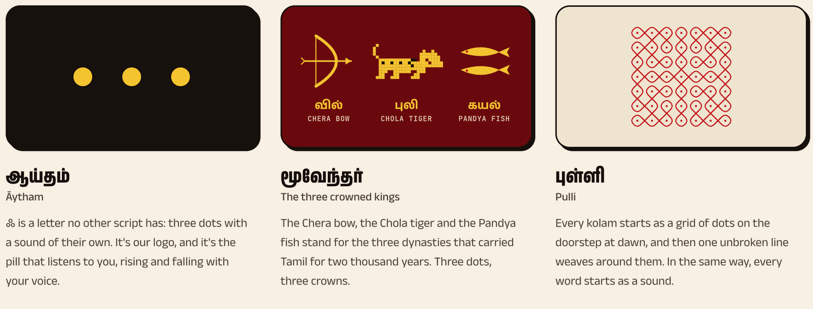</p>

Three dots are three things at once: **ஃ**, the letter no other script has; the **Muvendar**, the Chera, Chola and
Pandya kingdoms that carried Tamil for two thousand years; and the **pulli** of a kolam, the grid of dots one
unbroken line weaves around at dawn. Every pattern here is generated from the Chola century, from the sikku
kolam to the pixel vimana of Rajaraja Chola's Big Temple at Thanjavur, finished in 1010 CE, its walls carved
with Tamil inscriptions.

<p align="center">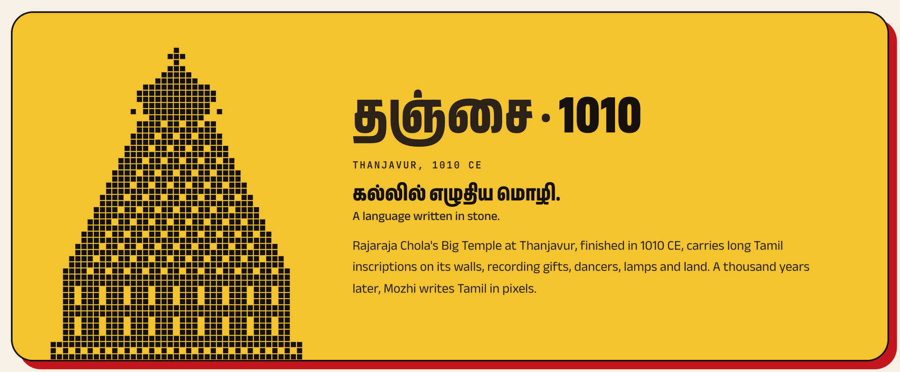</p>

## பங்களிக்க · Contributing

See [CONTRIBUTING.md](CONTRIBUTING.md). Tamil speakers who can test accuracy across dialects (Chennai, Kongu,
Madurai, Tirunelveli, Jaffna, Malaysian and Singaporean Tamil) are especially welcome. Use the
[accuracy report](https://github.com/Kamal007OLica/mozhi/issues/new/choose) to tell us where Mozhi mishears you.

## அன்னைத் தமிழுக்கு · Made with love

<p align="center">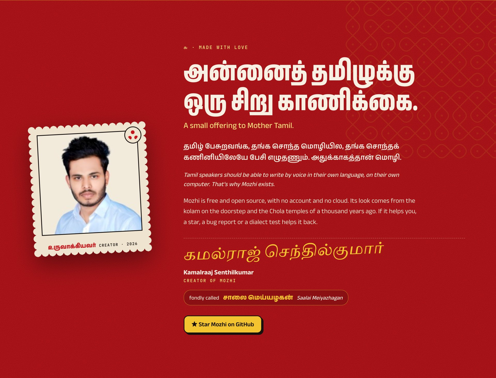</p>

Created by **Kamalraaj Senthilkumar** (சாலை மெய்யழகன், *Saalai Meiyazhagan*), as a small offering to Mother Tamil.

## உரிமம் · License

[Apache-2.0](LICENSE). Fonts are under the SIL Open Font License 1.1. Whisper models are MIT-licensed by OpenAI.

<p align="center">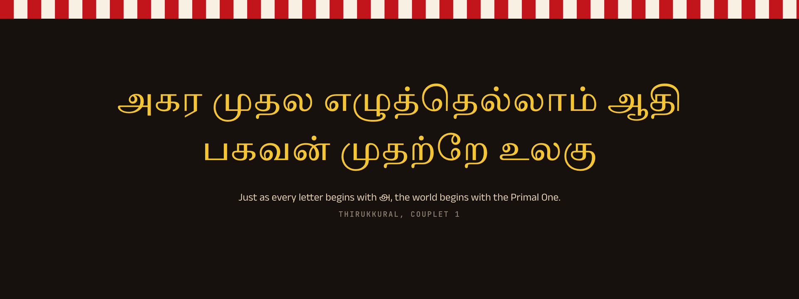</p>
